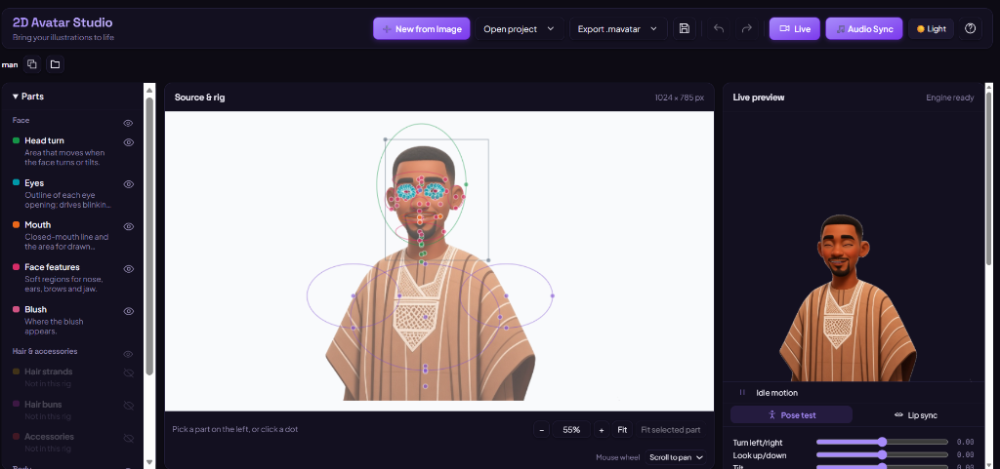
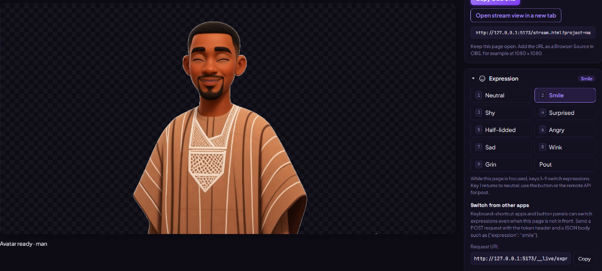
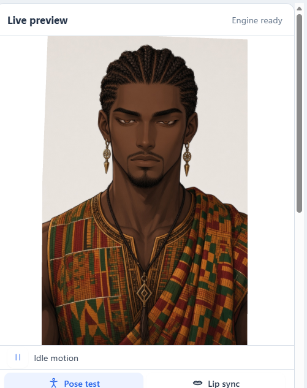
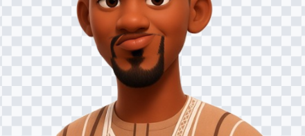

# 2D Avatar Studio

Turn any single illustration into an interactive, animated 2D avatar: it blinks, speaks, tilts and turns its head, breathes, and sways naturally. 

**2D Avatar Studio** features a full dark-mode editor, real-time WebGL mesh deformation, microphone & audio-file lip sync, camera tracking, and customizable expressions.



---

## ✨ Features

- 🎨 **Modern Dark & Light Themes** — Designed with a deep violet/amethyst creative dark palette, customizable typography, and an instant theme toggle.
- ⚡ **Direct Image Upload** — Drop or select any PNG illustration directly to start rigging without manual file renaming.
- 🗣️ **Real-Time Lip Sync & Audio Sync** — Built-in vowel analysis and sensitivity controls for speech playback and live microphone audio.
- 🎭 **Rich Expressions & Drawn Variants** — Switch smoothly between neutral, smile, surprised, shy, angry, grin, pout, and half-lidded eyes.
- 🎥 **Live Studio & OBS Integration** — Real-time camera face tracking, custom chroma backgrounds (green, blue, dark, transparent), and instant OBS Browser Source streaming.
- 📦 **Standalone Export** — Export avatars as compact `.mavatar` files to play or share anywhere.

---

## 📸 Screenshots

| Studio Rig Editor | Live Streaming & Expressions |
|:---:|:---:|
|  |  |

| Live Preview & Physics | Custom Mouth & Eye Variants |
|:---:|:---:|
|  |  |

---

## 🚀 Quick Start

### Prerequisites
- **Node.js 22.17+**
- **Git**
- *(Optional)* Python 3.10+ with `uv` for layer generation

### 1. Installation

```sh
git clone https://github.com/tomladsn/2d-Avatar-Studio.git
cd 2d-Avatar-Studio
npm install
```

### 2. Launch Local Studio

```sh
npm run dev
```

Open your browser at `http://localhost:5173/` (or the URL printed in the terminal).

---

## 🛠️ How It Works

### 1. Import or Upload an Illustration
Click **+ New from Image** or drop a PNG into the editor. 2D Avatar Studio prepares the initial layer masks and sets up coordinate reference points.

### 2. Fine-tune the Rig Points
Select facial regions (eyes, mouth, face outline, chin, neck) on the left panel. Drag the control handles on the source image to align with your illustration. The real-time preview updates instantly.

### 3. Add Expressions & Mouth Variants
Upload or generate drawn eye variants (closed, smiling, surprised) and mouth variants (rest, open vowels, wide grin, pout).

### 4. Broadcast with Live Studio
Click **Live** to open the real-time tracking interface:
- Use your webcam for facial tracking
- Use your microphone or loaded audio file for automatic mouth synchronization
- Copy the OBS Browser Source link directly into OBS Studio with a transparent or green-screen background!

---

## 🧪 Verification & Tests

To ensure deformation regressions remain at 0 px:

```sh
npm run lint
npm test
npm run build
```

---

## 📄 License

The code is licensed under the [MIT License](LICENSE).

Face tracking is powered by [MediaPipe](https://github.com/google-ai-edge/mediapipe) under the Apache License 2.0.
